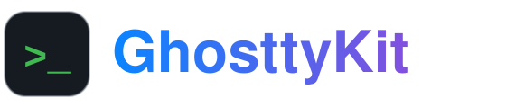
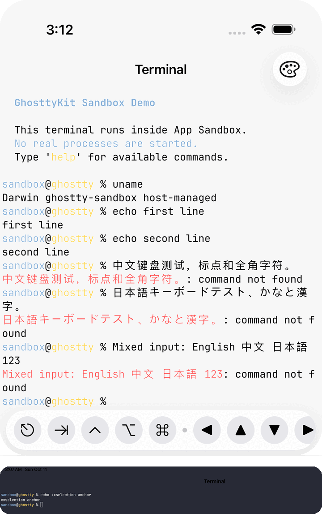
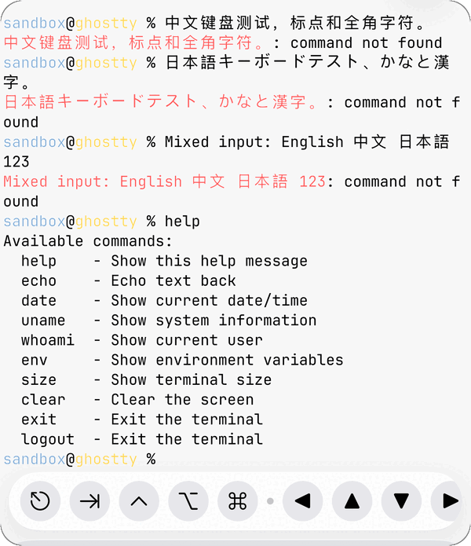
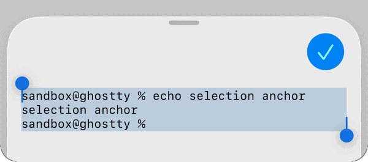
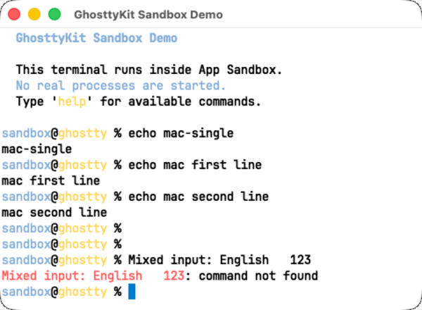
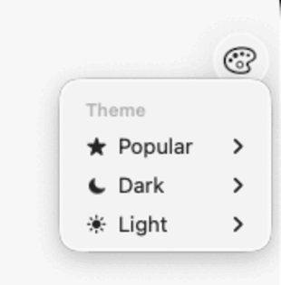

<p align="center">
  
</p>

<p align="center">
  <strong>Ghostty's terminal engine, as a Swift package.</strong><br>
  Put a fast, native, GPU-rendered terminal in your iPhone, iPad, Mac or Vision Pro app with a few lines of SwiftUI.
</p>

<p align="center">
  <a href="#quick-start"></a>
  <a href="#features"></a>
  <a href="https://github.com/umeranjum17/libghostty-spm/tags"></a>
  <a href="LICENSE"></a>
</p>

<p align="center">
  
</p>
<p align="center"><sub>The bundled sample app in day and night, captured by this repository's UI tests on iPhone and iPad.</sub></p>

## Why

[Ghostty](https://ghostty.org) has one of the best terminal cores around, but it ships as a Zig library.
Getting it into an Apple app means cross-compiling Zig for every platform, writing C glue for rendering
and callbacks, and building keyboard, IME, touch and clipboard handling yourself.

GhosttyKit does that work for you. You get a prebuilt XCFramework, a SwiftUI view, and an input stack
built for touch and hardware keyboards. It works under App Sandbox, so your app can feed it bytes from
SSH, a WebSocket or a simulated shell instead of spawning processes.

## See it in action

<table>
  <tr>
    <td width="50%" valign="top">
      <br>
      <b>Type in any script</b><br>
      <sub>Software and hardware keyboards, CJK input methods, and a key bar with Esc, Tab, arrows and sticky Ctrl/Alt/Cmd.</sub>
    </td>
    <td width="50%" valign="top">
      <br>
      <b>Long-press to select</b><br>
      <sub>Touch selection hands the viewport text to your app, pre-selected around the word under the finger.</sub>
    </td>
  </tr>
  <tr>
    <td width="50%" valign="top">
      <br>
      <b>Native on the Mac</b><br>
      <sub>An AppKit view with full text-input-client IME support, sandboxed like the iOS app.</sub>
    </td>
    <td width="50%" valign="top">
      <br>
      <b>485 themes, light and dark</b><br>
      <sub>Pick a light and a dark theme; the terminal follows the system appearance.</sub>
    </td>
  </tr>
</table>

## Quick start

**1. Add the package.** In Xcode choose *File › Add Package Dependencies…* and paste the URL, or add it to `Package.swift`:

```swift
.package(url: "https://github.com/umeranjum17/libghostty-spm.git", from: "1.5.2")
```

**2. Link the products.** Add `GhosttyTerminal` (the terminal view) and `ShellCraftKit` (a sandboxed demo shell) to your app target:

```swift
.product(name: "GhosttyTerminal", package: "libghostty-spm"),
.product(name: "ShellCraftKit", package: "libghostty-spm"),
```

**3. Show a terminal.** Run this view and you get the sandboxed shell from the screenshots. Try `help`, `uname` or `echo hi`:

```swift
import GhosttyTerminal
import ShellCraftKit
import SwiftUI

struct ContentView: View {
    @StateObject private var terminal = TerminalViewState()
    @State private var shell = ShellSession(shell: defaultSandboxShell)

    var body: some View {
        TerminalSurfaceView(context: terminal)
            .onAppear {
                terminal.configuration = TerminalSurfaceOptions(
                    backend: .inMemory(shell.terminalSession)
                )
                shell.start()
            }
    }
}
```

To connect a real backend, swap the demo shell for your own `InMemoryTerminalSession`. Its `write` closure
gets the terminal's input bytes, and `receive(_:)` feeds output back in. See the [usage guide](#reference) below.

## Features

- **Ghostty's real engine.** It runs the same VT parser, grid and Metal renderer as the Ghostty app, with CoreText fonts. Each build pins a recent commit from Ghostty's main branch.
- **SwiftUI and UIKit/AppKit.** `TerminalSurfaceView` for SwiftUI, and `TerminalView` for UIKit (iOS, iPadOS, Catalyst, visionOS) and AppKit (macOS).
- **Sandbox-safe I/O.** The in-memory backend never spawns a process. Your app moves the bytes, from SSH, a socket or a simulated shell. A PTY backend is there for hosts that are allowed to run processes.
- **Touch-first input.** Software and hardware keyboards, IME composition, a customisable key bar with sticky modifiers, pointer, trackpad and mouse reporting, and pinch to zoom.
- **Selection and clipboard.** Long-press selection, pastes that turn files and images into shell paths, drag and drop, and an OSC 52 prompt your app controls.
- **Themes.** `GhosttyTheme` ships 485 color schemes, with separate light and dark picks.
- **Shell integration.** Bundled bash and zsh scripts, written for this package and MIT-licensed, mark prompts so `jumpToPrompt(by:)` can move between them.

| Library           | What it gives you                                                                       |
| ----------------- | --------------------------------------------------------------------------------------- |
| `GhosttyTerminal` | The Swift terminal: views, SwiftUI state, input, rendering loop and host-managed I/O    |
| `GhosttyTheme`    | 485 color themes from [iTerm2-Color-Schemes](https://github.com/mbadolato/iTerm2-Color-Schemes) (MIT) |
| `ShellCraftKit`   | A sandboxed, simulated shell for demos and tests                                        |
| `GhosttyKit`      | The raw libghostty C API (`ghostty.h`), for advanced use                                |

Requires iOS 15, macOS 13, Mac Catalyst 15 or visionOS 1, or later.

## Links

- **Repository:** [umeranjum17/libghostty-spm](https://github.com/umeranjum17/libghostty-spm)
- **Versions:** [tags](https://github.com/umeranjum17/libghostty-spm/tags) · [releases](https://github.com/umeranjum17/libghostty-spm/releases) (XCFramework assets)
- **Docs:** [API guides](https://lakr233.github.io/libghostty-spm/) on the upstream site · the [reference](#reference) below
- **Examples:** [`Example/MobileGhosttyApp`](Example/MobileGhosttyApp) (iOS, iPadOS and Catalyst) · [`Example/GhosttyTerminalApp`](Example/GhosttyTerminalApp) (macOS)
- **Upstream:** [Lakr233/libghostty-spm](https://github.com/Lakr233/libghostty-spm), which this repository forks · [Ghostty](https://ghostty.org)

## Reference

These sections cover the full API and the build. Open the one you need.

<details>
<summary><b>Usage guide</b></summary>

Start from the example apps:

- `Example/GhosttyTerminalApp/` — macOS AppKit demo with delegate callbacks
- `Example/MobileGhosttyApp/` — iOS UIKit demo with keyboard, safe area, themes, and text selection

### SwiftUI (iOS 15+ / macOS 13+ / Mac Catalyst 15+ / visionOS 1+)

```swift
import SwiftUI
import GhosttyTerminal

struct ContentView: View {
    @StateObject private var terminal = TerminalViewState()
    private let session = InMemoryTerminalSession(
        write: { data in
            // Handle bytes produced by the terminal.
        },
        resize: { viewport in
            // Keep your host backend in sync with the terminal grid.
        }
    )

    var body: some View {
        TerminalSurfaceView(context: terminal)
            .navigationTitle(terminal.title)
            .onAppear {
                terminal.configuration = TerminalSurfaceOptions(
                    backend: .inMemory(session)
                )
            }
    }
}
```

A host that keeps several surfaces mounted at once (tabs hidden behind
`opacity(0)`) sets `terminal.isSurfaceVisible = false` on the hidden ones.
The surface keeps its grid, scrollback, and session; only rendering stops.

### UIKit / AppKit

```swift
import GhosttyTerminal

let terminalView = TerminalView(frame: .zero)
terminalView.delegate = self
terminalView.controller = TerminalController(configFilePath: path)
terminalView.configuration = TerminalSurfaceOptions(
    backend: .inMemory(session)
)
```

`TerminalView` is a type alias that resolves to `UITerminalView` (iOS/Catalyst) or `AppTerminalView` (macOS).

### Keys and Pasted Text

`TerminalViewState` and `TerminalView` expose the same two input paths, and
they are not interchangeable:

```swift
terminal.sendKey(.enter)                         // Press and release a key.
terminal.sendKey(.c, modifiers: .ctrl)           // Ctrl+C.
terminal.sendKey(TerminalKeyPress(typing: "C")!) // c with Shift, from the US layout.
terminal.paste(text: "ls -la")                   // A paste, not keystrokes.
```

`sendKey(_:)` is the key path (also on `TerminalSurface`): `TerminalKey`
mirrors every libghostty key, the press is encoded the way the program's key
mode expects, and a release follows. `paste(text:)` is the text path: a
program that enabled bracketed paste receives it framed as a paste, so a `\r`
in it is a pasted character, not Enter. `TerminalViewState.send(_:)` and
`AppTerminalView.sendText(_:)` are deprecated names of `paste(text:)` for that
reason — they never sent keystrokes. On `TerminalSurface` the text path keeps
its primitive name, `sendText(_:)`.

### Prompt and Scrollback Navigation

`TerminalViewState`, `TerminalView`, and `TerminalSurface` expose the same
programmatic navigation APIs:

```swift
terminal.jumpToPrompt(by: -1) // Previous prompt.
terminal.jumpToPrompt(by: 1)  // Next prompt.
terminal.scrollToRow(0)        // First absolute scrollback row.
```

Prompt navigation requires [shell integration](https://ghostty.org/docs/features/shell-integration),
which records prompt boundaries. The package bundles its own MIT-licensed
bash and zsh integration (OSC 133 prompt marks, OSC 7 working directory,
OSC 2 title, cursor shape) under `Resources/Ghostty/shell-integration`, and
the `.exec` backend injects it the way upstream Ghostty does; upstream's own
scripts are GPLv3 and are deliberately not shipped. Other shells get no
automatic integration. A host-managed backend must preserve or emit
equivalent OSC 133 prompt markers. Arbitrary Ghostty actions remain available
through `performBindingAction(_:)`.

### Pasting and Dropping Files

A paste reads the pasteboard the way Ghostty's macOS app does: URLs first —
a file URL as its shell-escaped path, any other URL verbatim — then the
string. A file copied in Finder or Files therefore pastes its path, never the
display name that sits beside it on the pasteboard. On iOS and Mac Catalyst,
image or document data with no path of its own (a screenshot, a photo, a file
copied out of Files) is written to a file first and the file's escaped path is
pasted.

Ghostty asks the host before a protected clipboard operation — a program
reading the clipboard through OSC 52, writing it when `clipboard-write = ask`,
or a paste that paste protection flagged — through
`TerminalViewState.onClipboardConfirmationRequest` (a delegate adopts
`TerminalSurfaceClipboardConfirmationDelegate`); the host presents the request
and answers `respond(allow:)`. While the hook is `nil`, a program's read or
write is denied silently and a paste the user started is allowed.

Dropping onto the terminal works the same way on iOS and Mac Catalyst: files
and images are copied into the staging directory and their escaped paths are
pasted; a dropped folder, link, or text pastes as text. Everything a drop
delivers travels the text path, like a paste — never as keystrokes.

Staged files live under `TerminalFileStaging.directory`, a `ghostty-paste`
folder in the app's temporary directory by default. A host whose shell cannot
read the app container points it somewhere both can reach before the first
paste or drop. Files stay until `TerminalFileStaging.staleFileAge` (24 hours)
has passed — swept whenever a new file is written, or on
`TerminalFileStaging.removeStaleFiles()`. A host calls
`TerminalFileStaging.removeAllFiles()` once no shell can reach the staged
files — its last shell ended, or the app is quitting together with its shells.

```swift
// A host that ends every shell when it quits.
func applicationWillTerminate(_: UIApplication) {
    endAllSessions()
    TerminalFileStaging.removeAllFiles()
}
```

### Surface Snapshots and Host View Subclasses

`TerminalView.snapshotImage()` renders the surface's current on-screen
contents into a `UIImage`/`NSImage`, and
`TerminalViewState.attachedPlatformView` hands the presenting view to hosts
that hold only the state. On UIKit the snapshot is a render-server pass
(`drawHierarchy`), so the Metal layer's presented frame is included; on AppKit
it is `cacheDisplay`, best-effort for Metal content.

Hosts that need their own view behavior — an interaction lock, custom hit
testing, a keyboard policy — set `TerminalViewState.makePlatformView` to
return a `TerminalView` subclass before the surface first appears; the
SwiftUI representable instantiates it instead of the base class. Policy
belongs in such a subclass, never in the byte stream: output keeps flowing
and rendering regardless. The overridable seams are everything UIKit/AppKit
give a view (`hitTest`, `canBecomeFirstResponder`) plus
`UITerminalView.toggleSoftwareKeyboard()`, which a clean tap calls after its
click has been sent — override it to keep a tap from raising or dismissing
the software keyboard.

#### Notes

- `TerminalViewState` is the SwiftUI state container.
- `TerminalView` is the UIKit/AppKit view typealias.
- `TerminalController` owns app lifecycle, config resolution, themes, and surface creation.
- `InMemoryTerminalSession` provides the host-managed backend used by the sandboxed example apps.
- `GhosttyThemeCatalog` exposes bundled iTerm2 color schemes.

</details>

<details>
<summary><b>Building from source</b></summary>

The package downloads a pre-built XCFramework. To rebuild libghostty from the Ghostty source:

```bash
# Requires: zig (CI builds with 0.16.0 — the pinned upstream's minimum_zig_version)
./build.sh
./build.sh --platforms macos,ios --source /path/to/ghostty --skip-tests
```

`build.sh` forwards to `Script/build.sh`. Without `--source` it clones Ghostty
into `References/ghostty-upstream`; `--ref` checks out a tag or commit there
(`Ghostty.ref` is the commit the shipped asset was built from). It applies the
patches in `Patches/ghostty/`, builds each platform group (`macos`, `ios`,
`maccatalyst`, `visionos` by default; macOS, Catalyst, and simulator slices
are arm64 and x86_64), assembles `BinaryTarget/GhosttyKit.xcframework` and
`build/GhosttyKit.xcframework.zip`, and runs `Script/test.sh` and `swift test`
against the result unless `--skip-tests` is given. `Package.local.swift`
points the binary target at that local `BinaryTarget/` build; `--download-url`
regenerates `Package.swift` from `Package.swift.template` for an uploaded zip.

The `visionos` group builds against a patched copy of the Zig standard
library only when `Patches/zig/` holds a patch for the Zig on PATH (staged
under `build/cache` by `Script/prepare-zig-lib.sh`; the toolchain itself is
never modified). Zig 0.16.0 needs none. Xcode 27 needs the Metal toolchain
component installed (`xcodebuild -downloadComponent MetalToolchain`); the
`Script/support/xcode27-sdk-overlay.sh` SDK overlay was for Zig 0.15.2,
which could not link its build runner against that SDK, and 0.16 does not
need it.

</details>

<details>
<summary><b>Versions and release tags</b></summary>

Pin `1.5.2` or later (`from: "1.5.2"`). The `1.4.0` … `1.4.13` and `1.5.0`
tags and releases were withdrawn and no longer exist; `1.5.1` is the
oldest live tag on this track and the first with visionOS slices. Versions
after `1.5.2` are `<major.minor>.<UTC YYYYMMDD>` (`1.5.20260906`): a
release lands every week with Ghostty pinned to upstream main's head of
that Monday (`Ghostty.ref`, a commit rather than a release, because
upstream tags rarely and main carries the fixes we need), the date is the
patch number so a `from:` pin takes each one, and major.minor moves only
for a breaking change to this package's API. Package tags are cut by the
"Release Package" workflow only; `Script/audit-releases.sh` checks every
tag's manifest against the asset it downloads.

`upstream.<sha12>` releases carry the XCFramework built from that Ghostty
commit (`upstream.<sha12>-<N>` when the same commit was rebuilt with a
changed patch stack or target set — `Ghostty.build` holds `N`). The older
`upstream.1.3.1`, `upstream.1.3.1-2` (the first asset with visionOS slices)
and `upstream.1.3.1-3` were named after the upstream release instead; each
package tag's `Package.swift` downloads one of these. Those and the still
older `storage.*` tags are XCFramework assets, not package versions. SPM
should not depend on them.

</details>

<details>
<summary><b>Trimmed build: what differs from upstream Ghostty</b></summary>

The bundled `libghostty` is a trimmed build optimized for sandboxed, embedded use on Apple platforms.

| Component                        | Upstream Ghostty | libghostty-spm   | Reason                                                                                                                                                |
| -------------------------------- | ---------------- | ---------------- | ----------------------------------------------------------------------------------------------------------------------------------------------------- |
| Terminal emulation core          | Yes              | Yes              | Full VT parser, state machine, grid — retained                                                                                                        |
| Metal renderer                   | Yes              | Yes              | GPU rendering via CAMetalLayer / IOSurface — retained                                                                                                 |
| Font rasterization & shaping     | Yes              | Yes              | CoreText font backend — retained                                                                                                                      |
| Configuration system             | Yes              | Yes              | All terminal config options — retained                                                                                                                |
| Input handling (key, mouse, IME) | Yes              | Yes              | Full keyboard/mouse/touch/IME pipeline — retained                                                                                                     |
| Text selection & clipboard       | Yes              | Yes              | Selection, copy/paste APIs — retained                                                                                                                 |
| Custom shaders (GLSL)            | Yes              | **No**           | `glslang` and `spirv-cross` removed (`-Dcustom-shaders=false`). Shadertoy/post-processing shaders are a desktop feature unnecessary for embedded use. |
| Terminal inspector (ImGui)       | Yes              | **No**           | `dcimgui` removed (`-Dinspector=false`). Debug inspector UI replaced with no-op stubs.                                                                |
| Sentry crash reporting           | Yes              | **No**           | Disabled (`-Dsentry=false`).                                                                                                                          |
| Native app runtime               | Yes              | **No**           | Cocoa/GTK/Wayland app shell disabled (`-Dapp-runtime=none`). The host app provides its own runtime.                                                   |
| Standalone executable            | Yes              | **No**           | No terminal `.app`, CLI binary, or upstream xcframework emitted (`-Demit-exe=false`, `-Demit-macos-app=false`, `-Demit-xcframework=false`).           |
| Documentation generation         | Yes              | **No**           | Skipped (`-Demit-docs=false`).                                                                                                                        |
| Frame data generator             | Build-time tool  | **Pre-compiled** | `framedata.compressed` shipped pre-built; framegen C tool dependency removed.                                                                         |
| Host-managed I/O backend         | No               | **Added**        | New `GHOSTTY_SURFACE_IO_BACKEND_HOST_MANAGED` for non-PTY, sandbox-safe terminal I/O.                                                                 |
| iOS Metal rendering fixes        | No               | **Added**        | IOSurface +1px tolerance, synchronous present, 64-byte row alignment for iOS.                                                                         |
| iOS platform fixes               | No               | **Added**        | Deployment target lowered to 15.0, private window blur API removed, kqueue fix for simulator.                                                        |
| macOS Metal texture storage      | No               | **Added**        | Shared textures on iOS and Apple GPUs, managed on Intel/AMD macOS GPUs.                                                                              |
| libc++ availability              | No               | **Added**        | Zig's libc++ headers built with Apple availability annotations; `__libcpp_verbose_abort` shipped in the archive so apps launch below iOS 16.3 / macOS 13.3. |
| Scroll remainder fix             | No               | **Added**        | Wheel scrolling keeps its sub-row remainder instead of zeroing it.                                                                                   |
| History replay                   | No               | **Added**        | `ghostty_surface_write_buffer_replay` feeds reconstructed history through the parser with terminal protocol responses suppressed.                     |

</details>

<details>
<summary><b>Fork releases</b></summary>

muxr's iOS app does not add this package as a SwiftPM dependency. It
downloads the pre-built `GhosttyKit` XCFramework from a muxr-suffixed
release and links the iOS slices it needs. The current release tag is
`storage.1.2.11-muxr.1`:

```text
https://github.com/umeranjum17/libghostty-spm/releases/download/storage.1.2.11-muxr.1/GhosttyKit.xcframework.zip
```

A muxr-suffixed release is a storage reference on this fork: the attached
zip is the build output, and the tag's source archive is not the build
input. `storage.1.2.11-muxr.1` rebuilds libghostty-spm `1.2.11` with a
backported upstream iOS callback-lifetime fix; it is not built from the
fork's current `main`. Only the iOS device (`ios-arm64`) and simulator
(`ios-arm64_x86_64-simulator`) slices are rebuilt for muxr; the macOS and
Mac Catalyst slices are the untouched `1.2.11` bytes. The release body
lists the SHA-256 of the zip and of each rebuilt library, and attaches the
exact-source rebuild recipe. The consuming app pins the zip's URL and
digest, so a new release means updating that pin.

</details>

## License

MIT License. See [LICENSE](LICENSE) for details.

The bundled `libghostty` binary is built from [Ghostty](https://ghostty.org), MIT License, Copyright (c) 2024 Mitchell Hashimoto, Ghostty contributors.

`Sources/GhosttyTerminal/Resources/terminfo/` is the `xterm-ghostty` terminfo entry compiled from Ghostty's `src/terminfo/ghostty.zig` (same MIT License and copyright).

`Sources/GhosttyTerminal/Resources/Ghostty/shell-integration/` is this package's own bash and zsh integration, MIT License, written from scratch — Ghostty's own bash and zsh integration scripts are GPLv3 and are not shipped. `bash/bash-preexec.sh` is vendored from [bash-preexec](https://github.com/rcaloras/bash-preexec), MIT License; see [LICENSE-bash-preexec.md](Sources/GhosttyTerminal/Resources/Ghostty/shell-integration/bash/LICENSE-bash-preexec.md).

`GhosttyTheme` color data comes from [iTerm2-Color-Schemes](https://github.com/mbadolato/iTerm2-Color-Schemes), MIT License; see [Sources/GhosttyTheme/LICENSE](Sources/GhosttyTheme/LICENSE).

## Sponsor

- [LookInside](https://lookinside-app.com/) helps you inspect a running iOS or macOS app UI from your Mac.
- This project is sponsored by AFK AI, INC.
